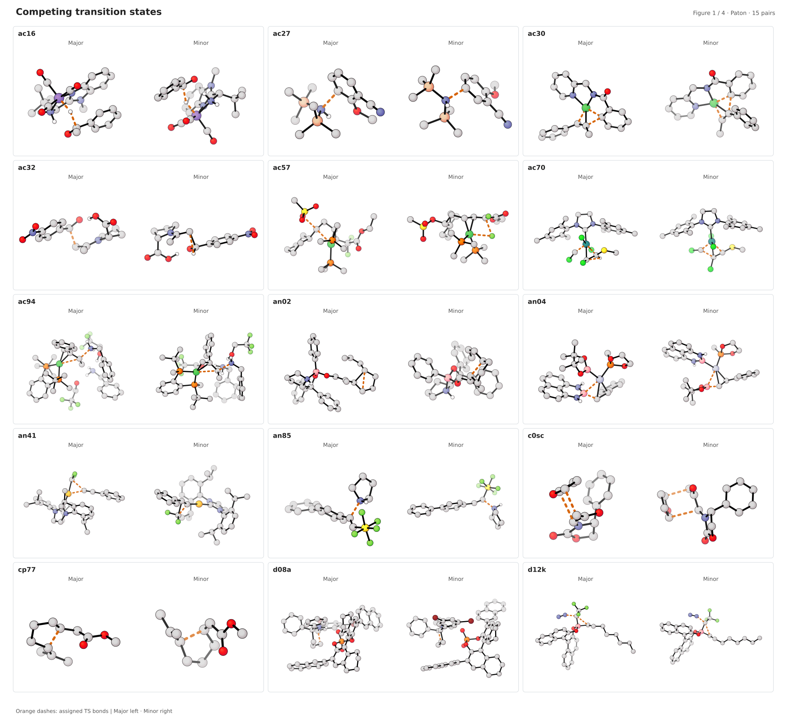
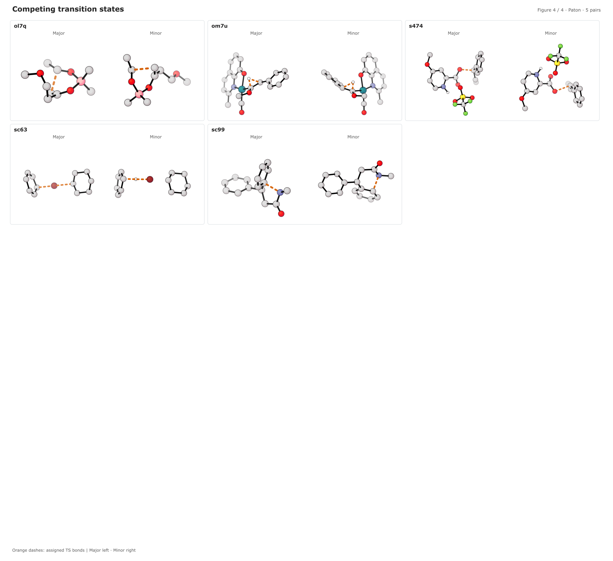

# SELECT50

**A benchmark dataset for evaluating machine-learned interatomic potentials in organic selectivity.**

This repository contains molecular geometries, energy differences, geometry comparisons, and supporting case studies for *Mapping Organic Selectivity with Machine-Learned Interatomic Potentials: Introduction of the SELECT50 Data Set*.

The core benchmark comprises **50 selectivity cases and 100 reference transition-state geometries**, reported as optimized at ωB97X-D3(BJ)/def2-TZVP. Eight comparison methods are represented alongside the reference geometries. Supporting datasets cover reaction landscapes, larger molecular systems, and calibration against experimental selectivity.

**Release status:** This is a research snapshot. Some experimental metadata, computational provenance, and figure-reproduction materials remain incomplete. A publication DOI and archived dataset DOI are not currently recorded in this repository.

The current [repository status](repository_status.md) distinguishes deposited materials from remaining gaps. Draft [case metadata and structure aliases](results/reference/README.md) are available for review; mechanism assignments, source corrections, and manuscript pathway roles still require confirmation.

## Transition-state gallery

The four render sheets show all **100 transition-state structures across 50 selectivity cases**, with the major structure on the left and the minor structure on the right of each pair. Case labels match the [reference structure filenames](results/reference/starting_structures/). Select a sheet to open the full-size SVG.

[](assets/figure_01.svg)

[](assets/figure_02.svg)

[](assets/figure_03.svg)

[](assets/figure_04.svg)

## Data inventory

| Dataset | Contents | Location |
| --- | --- | --- |
| Reference structures | 100 XYZ files: two transition states per selectivity case | [Starting structures](results/reference/starting_structures/) |
| Case metadata and aliases | 50 SI-transcribed case rows with proposed mechanism types; 100 aliases preserving reference XYZ source labels | [Metadata guide](results/reference/README.md) |
| Optimized structures | Nine geometry sets, each containing 100 XYZ files; reference copies are byte-identical to the starting structures | [Optimized geometries](optimized-geometries/) |
| Selectivity energies | Electronic-energy and Gibbs-energy differences for 50 cases | [ΔE](results/energetics/delta_e.csv), [ΔG](results/energetics/delta_g.csv) |
| Geometry comparisons | 800 heavy-atom RMSDs and 1,512 bond-distance rows; rotational `ja1g_major` has no assigned forming/breaking bond | [Geometry tables and assignments](results/geometry/) |
| Cycloaddition landscape  | Ten stationary-point structures, Gibbs energies, a 100-point two-dimensional scan, IRC trajectories, and activation-strain tables | [Cycloaddition data and methods](reaction_landscapes/cycloaddition/README.md) |
| Palladium-cyclization landscape  | 21 UMA stationary-point structures, Gibbs energies, spectator-adjusted profiles, IRC/NEB paths, a 73-point dihedral scan, and 22 published DFT geometries | [Palladium data guide](reaction_landscapes/palladium_cyclization/README.md) |
| Larger systems | Six transition-state pairs: 12 optimized XYZ files and 12 DFT starting geometries | [Large-system data guide](large_systems/README.md) |
| Selectivity calibration  | Ni and Pd transition-state pairs, calibration scripts, saved 100-split memberships, held-out predictions, and fit/error summaries | [Ni study](calibration/nickel_epoxide_arylation/README.txt), [Pd study](calibration/palladium_enone_addition/README.md) |
| Perturbed-guess recovery | Reserved directory; recovery inputs and results are not yet deposited | [Perturbed guesses](results/perturbed_guesses/) |

## Data conventions

- **Coordinates and distances:** XYZ coordinates, RMSDs, and bond distances are expressed in ångströms (Å). Bond-table atom indices are one-based.
- **RMSD methodology:** The supplied [RMSD script](scripts/calculate_heavy_atom_rmsd.py) uses NumPy's Kabsch fit with atoms paired by XYZ order. Hydrogen is excluded, and all remaining atoms contribute equally with no outlier rejection. It reproduces all 800 deposited comparisons within 0.000001 Å. See the [equations and method details](results/geometry/README.md#rmsd-methodology), including the distinction from PyMOL `align` with `cycles=0`. All-atom RMSDs in supporting tables include hydrogen and are distinct from heavy-atom RMSDs.
- **Energy differences:** The core ΔE and ΔG headers specify kcal/mol. Differences use `minor_minus_major`. Reaction-landscape tables distinguish absolute energies in hartree from relative energies in kcal/mol where indicated in their headers.
- **Structure identifiers:** Core XYZ files use `<case_id>_major.xyz` and `<case_id>_minor.xyz`. Major/minor labels follow the supplied reference electronic-energy ordering. The working SI assigns roles by Gibbs energy instead, so [draft aliases](results/reference/structure_aliases.csv) remain pending confirmation. Existing case IDs and file roles are retained.
- **Methods:** Geometry folders include eSEN, g-xTB, MACE-OMOL, UMA-M, UMA-S, PBE0-D3(BJ)/def2-SVP, r2SCAN-3c, and ωB97X-D3(BJ)/def2-SVP, alongside the ωB97X-D3(BJ)/def2-TZVP reference.
- **UMA versions and interface:** Landscape records identify **UMA-S-1.1** with ORCA's external-method interface. The working manuscript/SI identify core **UMA-S-1.2** and **UMA-M-1.1**. The repository author confirmed UMA-M-1.1, and the core CSV/validator labels now agree. Large-system/calibration prose says UMA-S-1.1, but Prins XYZ comments identify UMA Small 1.2; those UMA-S checkpoint assignments remain unresolved. See the [study guides](large_systems/README.md) and [repository status](repository_status.md).
- **Thermochemistry and experimental selectivity:** Use the conditions and definitions associated with each study. The meaning of `spe_corr`, the full core thermochemistry protocol, and experimental selectivity metadata are not yet documented completely.

## Repository structure

```text
SELECT50/
├── assets/                         Banner and transition-state render sheets
├── optimized-geometries/<method>/<structure_id>/<structure_id>.xyz
├── results/
│   ├── reference/starting_structures/
│   ├── energetics/
│   ├── geometry/
│   └── perturbed_guesses/
├── reaction_landscapes/
│   ├── cycloaddition/
│   └── palladium_cyclization/
├── large_systems/
├── calibration/
│   ├── nickel_epoxide_arylation/
│   └── palladium_enone_addition/
├── scripts/
├── tests/
├── CITATION.cff
└── LICENSE, LICENSE-DATA, LICENSE-CODE
```

## Access and use

Clone the repository or download an archive from GitHub:

```sh
git clone https://github.com/apounder/SELECT50.git
cd SELECT50
git rev-parse HEAD
```

Record the commit hash with any analysis to identify the exact dataset snapshot. XYZ and CSV files can be read without installing project-specific software. Consult the [data guide](results/README.md) for the core benchmark and retain the supplied case IDs when comparing methods.

### Validation

The structural validator requires Python 3.10 or newer and uses only the standard library. The RMSD regression tests additionally require NumPy:

```sh
python3 scripts/validate_data.py
python3 -m unittest discover -s tests
```

The validator checks XYZ syntax, core case/method coverage, atom ordering, CSV schemas, bond distances, and local Markdown links. Bond coverage includes the assigned P1–C3 breaking bond for `ja1g_minor` and explicitly accounts for rotational `ja1g_major`, which has no assigned forming/breaking bond. These checks establish file consistency; they do not establish scientific correctness or reproduce the reported calculations.

### RMSD recalculation

```sh
python3 -m pip install numpy
python3 scripts/calculate_heavy_atom_rmsd.py --strict
```

The script reads `optimized-geometries/` and uses `wB97X-D3(BJ)-def2-TZVP` as the reference. It writes a separate `results/geometry/heavy_atom_rmsd_recalculated.csv` with source paths and per-comparison status. The deposited RMSD table is retained. See the [geometry guide](results/geometry/README.md#recalculate-the-benchmark) for options and verification results.

### Calibration analyses

The calibration scripts require NumPy and implement repeated-split linear fits of experimental ΔΔG against raw predicted ΔΔG. Saved outputs include train/test memberships, fitted coefficients, and held-out errors.

Both [Ni](calibration/nickel_epoxide_arylation/ni_series.csv) and [Pd](calibration/palladium_enone_addition/pd_series.csv) input tables use the headers expected by their scripts. Ni ee fields remain blank in the CSV, although the separately supplied SI Table S24 contains all 13 values. Experimental temperatures and references remain incomplete in both CSVs; two Pd ee values conflict with S24. The deposited ΔΔG values are retained. Both saved analyses contain 100 splits with seed `20260810`, but the Pd script currently requests 1,000; rerunning it overwrites the saved analysis with a different partition sample. See the [Ni notes](calibration/nickel_epoxide_arylation/README.txt) and [Pd guide](calibration/palladium_enone_addition/README.md) before regenerating results.

## License

Scientific data and documentation are licensed under [Creative Commons Attribution 4.0 International (CC BY 4.0)](LICENSE-DATA). Source code, tests, and repository automation and configuration are licensed under the [MIT License](LICENSE-CODE). See [LICENSE](LICENSE) for the scope of each license. Separately identified third-party material retains its original license and attribution notices.

## Contributions and questions

Corrections, additional calculation provenance, and benchmark submissions are welcome through GitHub issues and pull requests. See [CONTRIBUTING.md](CONTRIBUTING.md) for submission requirements. Include method/version identifiers, input coordinates, computational settings, energy units, optimized structures, raw outputs, and failed cases. Retain current case IDs and pair ordering until the naming map is finalized.
