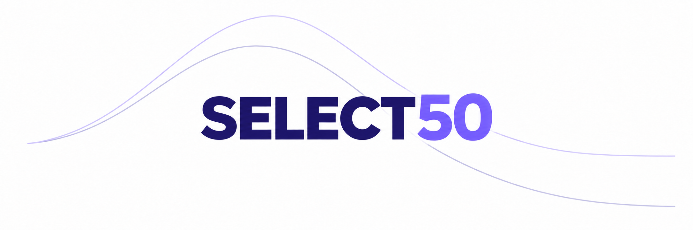
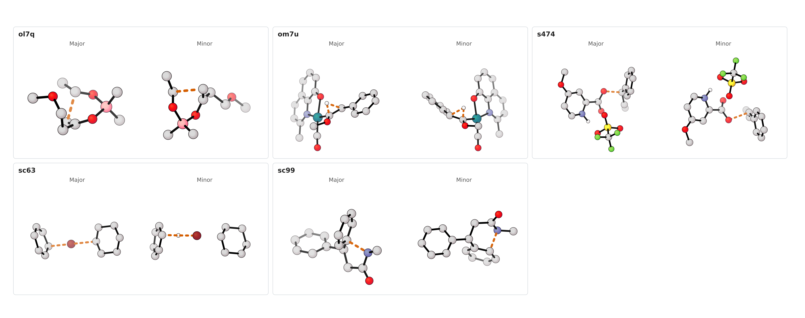

# SELECT50



## Overview

Data and scripts accompanying *Accelerating Mechanistic Understanding and Prediction of Chemical Selectivity with Foundation Machine-Learned Interatomic Potentials*.

SELECT50 contains 50 pairs of competing transition structures for comparing calculated reaction selectivities. The repository also includes transition-state recovery calculations, two reaction landscapes, six larger molecular systems, and calibration against experimental nickel- and palladium-catalyzed selectivities.

Reference geometries were optimized at ωB97X-D3(BJ)/def2-TZVP. The electronic-energy reference is ωB97M-V/def2-TZVPD on those geometries. Comparison methods include eSEN-medium, MACE-OMOL, UMA-M-1.1, UMA-S-1.2, g-xTB, r²SCAN-3c, PBE0-D3(BJ)/def2-SVP and ωB97X-D3(BJ)/def2-SVP. The reaction-landscape calculations use UMA-S-1.1.

## Data

| Dataset | Contents | Location |
| --- | --- | --- |
| Core benchmark | Reference structures, metadata, energy differences and geometry comparisons | [Data guide](results/README.md) |
| Optimized geometries | Method-specific transition structures | [XYZ files](optimized-geometries/) |
| Raw energies | Electronic and Gibbs energies, including MACE-OMOL thermochemistry | [Energy tables](results/energetics/) |
| Transition-state recovery | 300 perturbed-geometry calculations | [Calculations](ts_recovery/), [summary](results/perturbed_guesses/ts_recovery_full_data.csv) |
| Reaction landscapes | Stationary points, scans, IRCs and pathway comparisons | [Cycloaddition](reaction_landscapes/cycloaddition/), [palladium cyclization](reaction_landscapes/palladium_cyclization/) |
| Larger systems | Six transition-state pairs, DFT comparison structures, energies and timings | [Structures and tables](large_systems/) |
| Experimental calibration | Ni and Pd datasets with 100 training/test partitions each | [Nickel](calibration/nickel_epoxide_arylation/), [palladium](calibration/palladium_enone_addition/) |

Coordinates and geometric errors use ångströms; absolute energies use hartree and relative energies use kcal/mol. Major/minor roles are fixed by the reference electronic energies, with ΔΔE = E(minor) − E(major) and the same structure assignments for ΔΔG. See the [reference definitions](results/reference/README.md) for roles and exclusions.

### Transition-state gallery

[](assets/figure_01.png)

[](assets/figure_02.png)

[](assets/figure_03.png)

[](assets/figure_04.png)


## Usage

Clone the repository and check the data:

```sh
git clone https://github.com/apounder/SELECT50.git
cd SELECT50
python3 scripts/validate_data.py
```

The validator and calibration analysis use only the Python standard library. Reproduce both calibration datasets from their recorded partitions with:

```sh
python3 calibration/refresh_saved_calibration.py
```

To recalculate heavy-atom RMSDs and run all tests, install NumPy:

```sh
python3 -m pip install numpy
python3 scripts/calculate_heavy_atom_rmsd.py --output rmsd_recalculated.csv
python3 -m unittest discover -s tests
```

The [RMSD guide](results/geometry/README.md) describes atom matching and alignment. Calculation examples include a [MACE-OMOL driver](examples/calculations/opt_mace_omol.py) and ORCA/UMA templates for [minima](examples/calculations/job_orca.inp), [transition states](examples/calculations/job_orca_ts.inp), [scans](examples/calculations/job_orca_scan.inp) and [IRCs](examples/calculations/job_orca_irc.inp). The driver documents its calculation dependencies and command-line options; run it with `-h` for help.

## Citation

Please cite the [repository](CITATION.cff) when using these data or scripts. Record the version with `git rev-parse HEAD` and include that commit hash with the repository URL.

## License

Scientific data and documentation are licensed under [CC BY 4.0](LICENSE-DATA); source code, tests and repository configuration are licensed under the [MIT License](LICENSE-CODE). See [LICENSE](LICENSE) for scope. Separately identified third-party material retains its original license and attribution.

Contributions are welcome through GitHub issues and pull requests. See [CONTRIBUTING.md](CONTRIBUTING.md).
